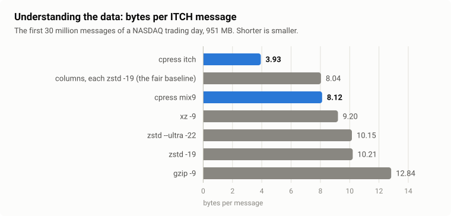
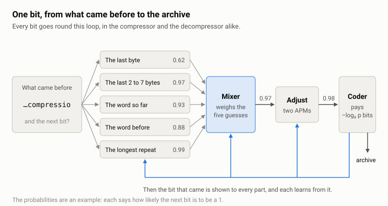
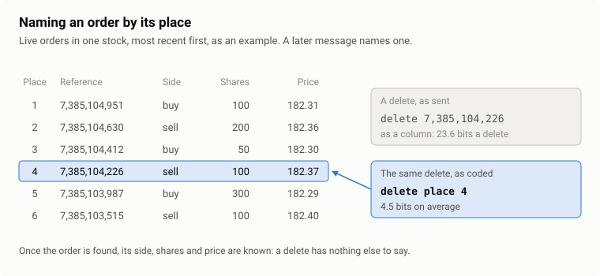
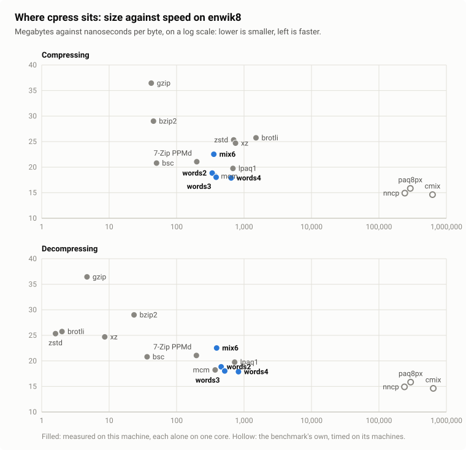
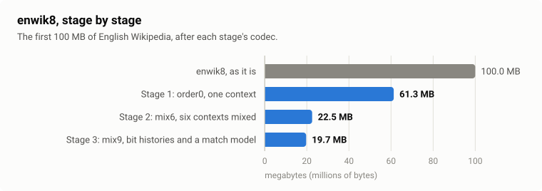

# cpress

[](https://github.com/Criseda/cpress/actions/workflows/ci.yml)
[](https://github.com/Criseda/cpress/tags)
[](LICENSE)
[](#build)
[](#build)

> The key to compression is to understand the data you want to compress.
>
> Matt Mahoney, [*Data Compression Explained*](https://mattmahoney.net/dc/dce.html#Section_15), section 1.5

**cpress is a lossless compressor that works by prediction.** Before each
bit of a file it asks many small models what comes next, mixes their
answers into one probability, and pays almost nothing for a bit it
predicted well. Written from scratch in C++20, with no dependencies.

| Input | As it is | cpress | For comparison |
|---|---|---|---|
| `enwik8`, the first 100 MB of English Wikipedia | 100 MB | **18.8 MB** | `xz -9e` 24.7 MB, `zstd -22` 25.3 MB |
| `enwik9`, the first gigabyte of it | 1,000 MB | **151.5 MB** | mcm 0.83, the next smaller program on the benchmark, 144.9 MB |
| A day of NASDAQ ITCH market data | 8,251 MB | **1,044 MB** | every field a column, each `zstd -19`: 2,160 MB |

The same engine does both. What differs is what the model knows:

<picture>
  <source media="(prefers-color-scheme: dark)" srcset="docs/figures/understanding-dark.svg">
  
</picture>

*`mix9` sees the feed as bytes; `itch` sees the orders the bytes describe.
Same coder, same mixer, less than half the size.*

## How it works

<picture>
  <source media="(prefers-color-scheme: dark)" srcset="docs/figures/pipeline-dark.svg">
  
</picture>

- **Predict.** Small models each guess the next bit from what came before:
  the last few bytes, the word being spelled, the last time these bytes
  appeared.
- **Mix.** A tiny learned network weighs the guesses into one
  probability, trusting whichever models have lately been right here.
- **Pay.** An arithmetic coder writes the bit in −log₂ *p* bits. A bit
  predicted at 0.999 costs 0.0014 bits; the same prediction, wrong, costs 10.
- **Learn.** Every part learns from the true bit. Nothing is trained in
  advance, so the archive carries no model: the decompressor rebuilds it,
  bit for bit, as it decodes.

For market data the models change, not the engine. `itch` keeps the book
of live orders, and names an order by its place among its stock's recent
orders instead of by its 64-bit number:

<picture>
  <source media="(prefers-color-scheme: dark)" srcset="docs/figures/order-place-dark.svg">
  
</picture>

**[How cpress works](docs/write-up.md)** explains every part from the
coder up, with diagrams, for readers new to compression and readers who
know it: what each part is worth, where cpress sits among other
compressors, why it is not a language model, and every measurement with
the commit that made it.

## Results

<picture>
  <source media="(prefers-color-scheme: dark)" srcset="docs/figures/ratio-speed-dark.svg">
  
</picture>

*Lower is smaller, left is faster. Filled points were measured on one
machine, each program alone on one core; hollow ones are the Large Text
Compression Benchmark's own, timed on other machines. cpress codecs that
another beats both on size and speed are left out.*

| Input | cpress | For comparison | Record |
|---|---|---|---|
| `enwik8`, the first 100 MB of English Wikipedia | **17,880,631 bytes**, 1.430 bits a byte (`words4`) | `mix9`: 19,687,838. mcm 0.83: 18,234,412 | [stage 10](docs/write-up.md#stage-10-codec-8-words4) |
| `enwik9`, the first 1 GB | **143,070,644 bytes**, 1.145 bits a byte (`words4`) | `mix9`: 165,953,692. With the decompressor, 143,193,451, under drt\|lpaq9m's 144,054,338 and faster both ways than its listed times. mcm 0.83: 144,854,575, faster | [stage 10](docs/write-up.md#stage-10-codec-8-words4) |
| A NASDAQ ITCH day, 8.25 GB, 268,744,780 messages | **3.884 bytes a message** (`itch`) | Every field a column, each `zstd -19`: 8.036. `xz -9`: 9.261 | [stage 5](docs/write-up.md#stage-5-market-data) |
| Another day, not used in design | **3.843 bytes a message** | The columns: 7.901 | [stage 5](docs/write-up.md#stage-5-market-data) |

The price is speed: `words4` compresses `enwik9` at about 1.8 MB a second
and decompresses it at 1.6, because the decoder must predict every bit
again. cpress is an archival tool, for files written once and read rarely.

## Quick start

```
cmake -S . -B build
cmake --build build --config Release
build/Release/cpress c notes.txt              # writes notes.txt.cpz
build/Release/cpress d notes.txt.cpz out.txt
```

The binaries are in `build/Release/` on Windows and in `build/` elsewhere.

## Codecs

Each design that shipped is a codec. Its id is written in the archive, and
once shipped its output never changes.

| Codec | What it is | Stage |
|---|---|---|
| `stored` | No compression | |
| `order0` | The arithmetic coder and an order-0 model | 1 |
| `mix6` | Six hashed context models, orders 1 to 6, combined by a logistic mixer | 2 |
| `mix9`, the default | A bit history in each context, a match model, two word contexts, and two adaptive probability maps refining the mix; made faster in stage 4 without changing a byte of its output | 3, 4 |
| `itch` | The messages of a NASDAQ TotalView-ITCH 5.0 feed, coded against the orders they describe, with the same coder and mixer | 5 |
| `words` | Text with its frequent words replaced by codes from a dictionary of the input's own words, then `mix9`'s model with an order-7 table and four times the memory | 7 |
| `words2` | `words` with shortcuts: a byte the match model is sure of is coded as one decision, and the APMs and the mixer skip bits the model is already sure of | 8 |
| `words3` | `words2` with byte classes: two contexts of the classes of recent bytes, mixer weights chosen per bit by them, and no order-6 table | 9 |
| `words4` | `words3` with order 6 again and a second layer: two more mixers with weights chosen other ways, a mixer of the three, and a third APM. The smallest for text; experimental until `v1.4` | 10 |

Every codec but `mix9` is asked for by name: `--codec words2`.

## Build

Requires CMake 3.21+ and a C++20 compiler (MSVC, GCC or Clang). No other
dependencies.

```
cmake -S . -B build
cmake --build build --config Release
ctest --test-dir build -C Release --output-on-failure
```

Keep the project in a short path on Windows: MSBuild fails when paths
exceed 260 characters.

The decoder is fuzzed in CI with libFuzzer, which needs Clang:

```
CXX=clang++ cmake -S . -B build-fuzz -DCPRESS_FUZZ=ON
cmake --build build-fuzz --target cpress-fuzz cpress-fuzz-seeds
build-fuzz/cpress-fuzz-seeds seeds
mkdir -p corpus
build-fuzz/cpress-fuzz corpus seeds -max_len=4096
```

An input it reports reproduces with any compiler:
`cpress-fuzz-replay <file>`.

## Use

```
cpress c notes.txt            # writes notes.txt.cpz
cpress d notes.txt.cpz out.txt
cpress info notes.txt.cpz     # header: codec, sizes, checksum
cpress codecs
cpress c --codec itch 12302019.NASDAQ_ITCH50
```

- **Files are safe.** `cpress` never replaces an existing file unless you
  pass `-f`. The output is written under a temporary name and renamed into
  place once it is complete, so a failed run leaves no partial file and
  any old one as it was. `-f` replaces the file rather than writing into
  it: a symbolic link at the output's name becomes a regular file, and the
  new file has default permissions.
- **Memory.** `mix9` sizes its model to the input: about 4.3 MiB for a
  file of a kilobyte, 980 MiB for anything over 4 MiB. (`mix6` needs
  190 KiB to 640 MiB.) Decompression needs the same memory as compression
  did.
- **`itch`** reads and writes a block at a time, so the file can be larger
  than memory: its model is 12.3 MiB to 364 MiB, and decompression also
  holds the archive. Any file round-trips through it, but only ITCH 5.0
  messages, each preceded by its 2-byte length as in Nasdaq's day files,
  compress well.

## Benchmark

```
cpress-bench corpus/enwik8
cpress-bench --cpu 2 --repeat 3 corpus/enwik8
```

- **What it records.** Each file is compressed, decompressed and verified
  in its own process, then one row is appended to `bench-results.csv`:
  git commit, codec, sizes, the archive's CRC-32, bits per byte,
  nanoseconds per byte and MB/s each way, the number of repeats, peak
  memory, and how much of each model was on large pages. A file that is
  ITCH messages from end to end also gets its message count and the
  archive's bytes per message, and a row for `itch` the number of orders
  its table had to evict.
- **Inputs.** See [corpus/README.md](corpus/README.md) for where to get the
  files. `itch` is measured file to file, without holding the input, so a
  day file of any size can be benchmarked; its archive goes to the
  temporary directory and is removed. `bench/baselines.sh` runs the
  compressors it is compared with, and `cpress-columns` is the splitter
  that script uses.
- **Timings** vary by several percent from run to run. `--cpu N` pins the
  measuring process to logical processor N, which keeps it off the slower
  cores of a processor that has two kinds; `--repeat K` runs the round
  trip K times and reports the fastest of each direction. Compare rows
  only with rows from the same sitting. A `bench-results.csv` written by an
  older version has other columns, and the benchmark will not append to
  it: move it aside.

## Archive format (version 1)

All fields are little-endian.

| Offset | Size | Field |
|---|---|---|
| 0 | 4 | Magic `CPRS` |
| 4 | 1 | Format version |
| 5 | 1 | Codec id |
| 6 | 2 | Reserved, must be zero |
| 8 | 8 | Original size in bytes |
| 16 | 4 | CRC-32 of the original data |
| 20 | … | Codec payload |

Decompression rejects an archive whose decoded size or checksum does not
match the header.

| Id | Name | Payload |
|---|---|---|
| 0 | `stored` | The original bytes |
| 1 | `order0` | Arithmetic-coded bits, then 4 flush bytes (frozen at `v0.1`) |
| 2 | `mix6` | One byte, the model's memory level; then arithmetic-coded bits and 4 flush bytes (frozen at `v0.2`) |
| 3 | `mix9` | As `mix6`, with a level of 10 to 23 (frozen at `v0.3`) |
| 4 | `itch` | One byte, the model's memory level, 10 to 23; then arithmetic-coded bits and 4 flush bytes (frozen at `v0.5`) |
| 5 | `words` | One byte, the model's memory level, 10 to 25; the size of the word stream, 8 bytes; then arithmetic-coded bits and 4 flush bytes (frozen at `v1.1`) |
| 6 | `words2` | As `words`, with a flag before some bytes (frozen at `v1.2`) |
| 7 | `words3` | As `words2`, with a larger model (frozen at `v1.3`) |
| 8 | `words4` | As `words3`, with a larger model (experimental until `v1.4`) |

<details>
<summary><b>Each codec's payload in detail</b></summary>

`order0`, `mix6` and `mix9` code each byte most significant bit first. Every bit is
coded with a 12-bit probability P(bit = 1) from the model, by a carryless
32-bit binary arithmetic coder. The coded part of the payload is exactly the
coder's output; the decoder must consume it exactly, and the header's
original size may not exceed 4096 times its size.

The level byte of `mix6` is 10 to 22; any other value is rejected. Each of
the model's larger tables has 2^level slots of 32 bytes, which comes to
192 KiB of tables at level 10 and 640.5 MiB at level 22. The compressor
picks the smallest level with 2^level at least the input size. The
decompressor allocates what the archive's level calls for, so the level can
be chosen differently later without a format change.

The level byte of `mix9` is 10 to 23, chosen and checked by the same rules.
Each of its eight history tables has 2^level slots of 16 bytes, except that
orders 1 and 2 never have more than 2^14 and 2^22. Its match model has a
buffer of 2^level × 16 bytes. With fixed tables of 4.2 MiB that comes to
4.3 MiB at level 10 and 980.4 MiB at level 23.

`itch` does not code bytes. Its bits code a sequence of things, each either
an ITCH 5.0 message or one byte that is not part of a message, so that any
input round-trips. A message is recognised by its 2-byte big-endian length
being the length of the type that follows; the length is not coded, and the
fields are coded in an order of the model's choosing, as differences from
what the orders seen so far predict ([docs/stages/stage-5.md](docs/stages/stage-5.md)).
A message can cost fewer bits than it has bytes, so the header's original
size may be up to 33,792 times the payload's size. The level is the base-2
logarithm of the number of orders the model can hold at once: 12.3 MiB of
model at level 10, 364 MiB at 23, the smallest level whose table has an
entry for every 8 bytes of input.

`words` codes a word stream, not the input. The stream is a header naming
its code bytes and flags, a dictionary of the input's words seen at least
16 times, one to a line, then the input with each of those words replaced
by a code of one to three bytes, a flag before a capitalised one, and an
escape before any byte that would be read as a code or a flag
([src/text/word_transform.hpp](src/text/word_transform.hpp)). The stream
is coded as `mix9` codes bytes, with an order-7 table too and levels up to
25: 4.3 MiB of model at level 10, 4,228.4 MiB at 25. The decoder checks
every field of the stream as it reads it, and the stream must expand to
exactly the header's original size.

`words2` codes the same stream with the same model and shortcuts
([docs/stages/stage-8.md](docs/stages/stage-8.md)). While a long match runs,
a byte may start with a flag, one decision: "the byte is the match's
guess". If it is, the byte has no bits; if not, its bits follow, except a
last bit the guess rules out. A byte can cost one decision instead of
eight, so the stream may be up to 32,768 times the size of the bytes
coding it. Its model is 4.3 MiB at level 10 and 4,236.4 MiB at 25.

`words3` codes the same stream as `words2`, flag and all, with a larger
model ([docs/stages/stage-9.md](docs/stages/stage-9.md), section 3): two
history tables keyed by the classes of the last 12 and 6 bytes, none for
order 6, and 262,144 mixer weight sets chosen per bit. Its model is 24.4
MiB at level 10 and 4,768.5 MiB at 25.

`words4` codes the same stream again, with `words3`'s model, order 6 and
a second layer ([docs/stages/stage-10.md](docs/stages/stage-10.md),
section 2): two more mixers of the same inputs, one choosing its weights
by the last two bytes and one by the word's length, a mixer of the three,
and a third APM keyed by the last three bytes. Its model is 160.5 MiB at
level 10 and 5,416.5 MiB at 25.

</details>

## Design rules

The full conventions are in [docs/style.md](docs/style.md).

- One predictor, shared exactly by compressor and decompressor.
- Integer-only model arithmetic, so archives decode bit-identically on every
  compiler and platform.
- Models composed at compile time; no virtual calls in the per-bit loop.
- Once a stage is tagged, its codec ids and their output are permanent.

## Roadmap

<picture>
  <source media="(prefers-color-scheme: dark)" srcset="docs/figures/stages-dark.svg">
  
</picture>

| Stage | Goal | Target on enwik8 (100 MB) |
|---|---|---|
| 0 | Harness: container, CLI, tests, benchmark | done |
| 1 | Binary arithmetic coder + order-0 model | done: 61.3 MB (target 64 MB or better) |
| 2 | Hashed order 1–6 models + logistic mixer | done: 22.5 MB (target under 25 MB) |
| 3 | Bit-history states, probability maps, match model | done: 19.7 MB (target 20 MB or better) |
| 4 | Large pages, prefetching ahead; same archives | done: same archive, compress 32% faster, decompress 18% (target 25% and 10%) |
| 5 | Market data: an order-table model for exchange feeds | done, on an ITCH day file: 3.88 bytes per message, 52% under column-split + zstd (target 4.00 or better, and 45%) |
| 6 | Write-up and release | done: [the write-up](docs/write-up.md); `enwik9` 165,953,692 bytes, and 97,522 for the decompressor |
| 7 | Text, toward the benchmark's frontier | done: `words`, `enwik9` 151,906,618 bytes and 104,990 for the decompressor, compressing in 365 ns a byte (target under 160,364,392 in all, and 394 ns) |
| 8 | Shortcuts: a predicted-byte flag, and work skipped where the model is sure | done: `words2`, `enwik9` 151,497,460 bytes and 112,714 for the decompressor, compressing 18% and decompressing 14% faster than `words` (target smaller than `words` and faster both ways) |
| 9 | Past mcm 0.83: codec 7 | done, `v1.3`: `words3`, `enwik9` 144,613,104 bytes and 121,219 for the decompressor, 144,734,323 in all, compressing at 344.7 ns a byte and decompressing at 409.0 (target under 144,934,149 in all, compressing under 394 and decompressing under 898) |
| 10 | Up the frontier: codec 8 | done, awaiting `v1.4`: `words4`, `enwik9` 143,070,644 bytes and 122,807 for the decompressor, 143,193,451 in all, compressing at 544.9 ns a byte and decompressing at 620.8 (target under 144,054,338 in all, drt\|lpaq9m's, compressing under 868 and decompressing under 898) |

## Layout

| Path | Contents |
|---|---|
| `include/cpress/` | Public API |
| `src/` | Container, codec registry, checksum, file I/O, streaming |
| `src/coder/` | Binary arithmetic coder |
| `src/model/` | The `Predictor` concept, the models and the parts they are built from |
| `src/itch/` | The ITCH 5.0 schema, the order table and market state, and the message model |
| `src/text/` | The word transform of codecs 5 and 6 |
| `src/codec/` | The drivers that run a model over an input: bit by bit, and message by message |
| `src/cli/` | The `cpress` tool |
| `tests/` | Component, golden-archive, round-trip, corruption and mutation tests |
| `fuzz/` | The decoder's fuzz target, its seeds, and a replay tool for any compiler |
| `bench/` | The `cpress-bench` runner, the `cpress-columns` splitter and the baseline script |
| `corpus/` | Benchmark inputs (not tracked) |
| `docs/` | The write-up and its figures, the idea, roadmap, stage briefs and code style |

## Documentation

| Document | Contents |
|---|---|
| [docs/write-up.md](docs/write-up.md) | How cpress works, what each part is worth, and every measurement |
| [docs/idea.md](docs/idea.md) | Why the project exists, how context mixing works, goals and non-goals |
| [docs/roadmap.md](docs/roadmap.md) | Every stage in detail, with exit criteria |
| `docs/stages/stage-N.md`: [1](docs/stages/stage-1.md), [2](docs/stages/stage-2.md), [3](docs/stages/stage-3.md), [4](docs/stages/stage-4.md), [5](docs/stages/stage-5.md), [6](docs/stages/stage-6.md), [7](docs/stages/stage-7.md), [8](docs/stages/stage-8.md) | The design record, a brief for each stage: the plan, the alternatives measured and the one chosen, the exit criteria, and every departure from the plan with its reason. Stage 3's sets out the bit-history states and stage 5's the `itch` model, which the code cites |
| [docs/style.md](docs/style.md) | Code style and review checklist |

## Licence

Apache License 2.0; see [LICENSE](LICENSE).
