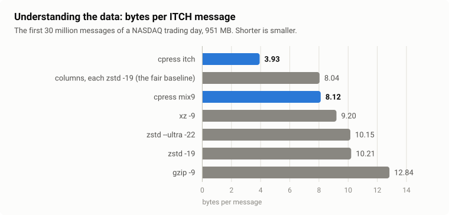
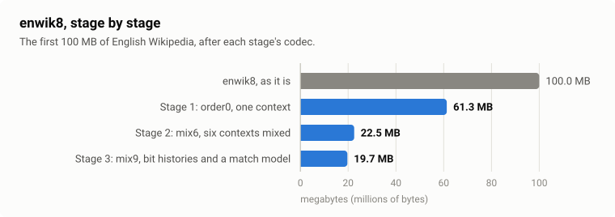
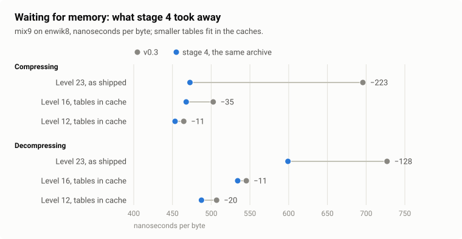
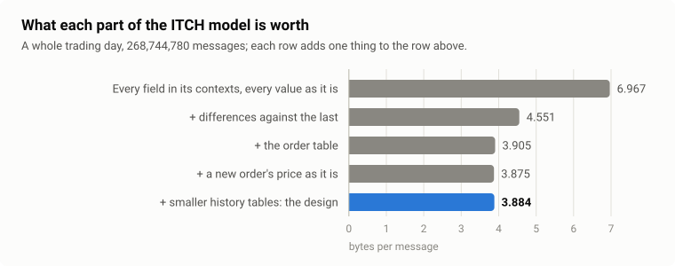
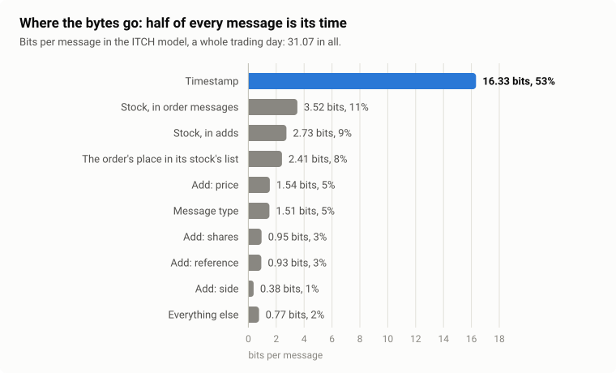
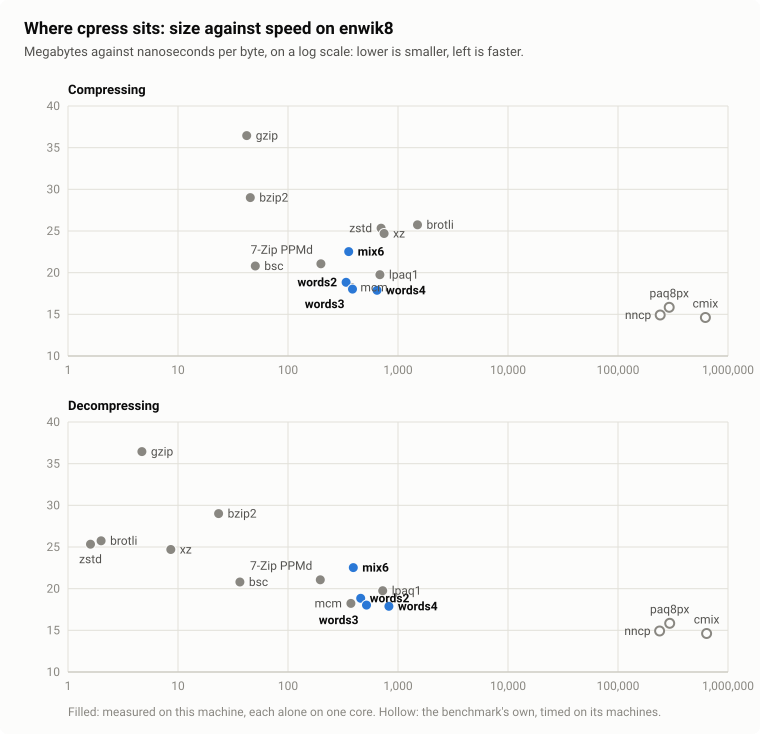

# How cpress works

> The key to compression is to understand the data you want to compress.
>
> Matt Mahoney, *Data Compression Explained*, section 1.5 [[1]](#references)

cpress is a lossless compressor written from scratch in C++20, with no
dependencies. It was built in seven stages, each ending in a number. This
document explains it from the bottom up: what each part does, why it is
there, and what it is worth, measured. It ends with where cpress sits among
other compressors.

The project has two results, and the second is the sentence above.

- **Text.** On `enwik8`, the first 100 MB of English Wikipedia, cpress's
  byte model makes 19,687,838 bytes: 1.575 bits a byte. That is the class
  of Matt Mahoney's lpaq1, and 0.3% smaller than lpaq1 itself
  [[2]](#references). Told what a word is, and given an order-7 table
  and more memory, the same engine makes 18,846,644, and on `enwik9`, the
  first gigabyte, 151,906,618: 8.5% smaller than the byte model, and
  faster.
- **Market data.** On a whole day of the NASDAQ TotalView-ITCH 5.0 feed,
  8.25 GB and 268,744,780 messages, cpress makes 3.884 bytes a message.
  That is 52% smaller than the best a careful engineer gets without a
  model: every field split into a column of its own and each column
  compressed with zstd. On a second day, not looked at while designing,
  51%.

The two results share an engine. The same arithmetic coder, the same
tables of bit histories, the same mixer turn text and market data into
bits. What differs is what the model knows. Given bytes, the text model
makes 8.12 bytes of each ITCH message; given the orders the messages
describe, the same engine makes 3.93.

<picture>
  <source media="(prefers-color-scheme: dark)" srcset="figures/understanding-dark.svg">
  
</picture>

*The first 30,000,000 messages of 30 December 2019, the slice every
program here was run on. Over the whole day `itch` makes 3.884.*

Every number in this document has a record: the
[appendix](#appendix-the-measurements) says which commit made it, on what
machine, and how. Every number about another program cites its source.

## Contents

1. [Compression is prediction](#1-compression-is-prediction)
2. [Many guesses, one answer](#2-many-guesses-one-answer)
3. [Remembering more than a count](#3-remembering-more-than-a-count)
4. [Waiting for memory](#4-waiting-for-memory)
5. [Understanding the data](#5-understanding-the-data)
6. [Understanding words](#6-understanding-words)
7. [Where cpress sits](#7-where-cpress-sits)
8. [Why it can be trusted](#8-why-it-can-be-trusted)
9. [What is left](#9-what-is-left)
10. [Appendix: the measurements](#appendix-the-measurements)
11. [References](#references)

## 1. Compression is prediction

No compressor makes every file smaller. There are more files of a
thousand bytes than there are of fewer bytes, so some must stay the same
size or grow [[1]](#references). A compressor wins on files where some
things are more likely than others, and it wins by knowing which.

Claude Shannon showed in 1948 that an event of probability *p* can be
coded in −log₂ *p* bits, and no fewer on average [[3]](#references). An
arithmetic coder comes within a fraction of a bit of that over a whole
file [[4]](#references). So a compressor is two things: a model, which
says how likely each possibility is, and a coder, which charges for what
happens. As *Data Compression Explained* puts it, "Coding is a solved
problem. Modeling is provably not solvable" [[1]](#references). The rest
of this document is about the model.

cpress predicts one bit at a time. Each byte is eight bits, most
significant first, and before each bit the model gives the probability
that it is a 1, as a whole number from 1 to 4095 out of 4096. The coder
then charges for the bit that came:

| The model said P(1) = | The bit was 1 | The bit was 0 |
|---|---|---|
| 0.5 | 1 bit | 1 bit |
| 0.9 | 0.15 bits | 3.3 bits |
| 0.999 | 0.0014 bits | 10 bits |

Confident and right is nearly free. Confident and wrong is expensive. A
better model is a smaller file, bit for bit.

The decompressor runs the same model on the bits it has decoded so far.
It sees the same probabilities in the same order, so it can run the coder
backwards. Nothing about the model is stored in the archive: both sides
build it as they go, from nothing. That puts one hard rule on the code.
The compressor and the decompressor must compute exactly the same
probability for every bit, on every machine, or the archive is garbage. So
the model uses no floating point anywhere; every probability and weight is
a fixed-point integer (section 8).

**The coder** is a binary arithmetic coder with 32 bits of state, after
the coder of Mahoney's lpaq and paq8 family. It keeps an interval
`[low, high]` and splits it in proportion to the probability: a 1 takes the
lower part, a 0 the upper. Each bit narrows the interval. When the top
byte of `low` and `high` agree, it can never change again, so it is
written out and the interval is scaled up by 256.

**The simplest model** is order 0. It predicts each bit from the bits of
the current byte seen so far, and from nothing before the byte. That is 255
contexts, each holding a probability that moves 1/32 of the way towards
every bit it sees: 512 bytes of model, which learns how common each byte
value is. On `enwik8` it makes 61,263,585 bytes, 4.90 bits a byte. Knowing
only that `e` is common and `}` is rare saves 39%.

## 2. Many guesses, one answer

The order-0 model knows which letters are common. It does not know that
after `compressio` comes `n`. That is a context: what came before. A model
of order *n* predicts the next bit from the last *n* bytes and what
followed them the last times they occurred.

Contexts of different lengths are good at different things. A short
context has been seen often, so it knows its statistics well, but it says
little. A long context says a lot when it has been seen at all, and often
it has not. Stage 2 runs six of them, orders 1 to 6, and has each predict
every bit.

**Tables.** There are far too many contexts of six bytes to give each its
own entry, so a context is hashed to a slot in a table, and two contexts
that land on one slot share it. A slot holds the predictions for half a
byte, a nibble: the fifteen nodes of the binary tree over its four bits.
So a table is looked up twice a byte, not eight times, and the four bits
of a nibble share one trip to memory. Each node holds a counter, a
probability that adapts fast while it has seen little and slowly once it
has seen a lot.

**Mixing.** Six predictions of one bit have to become one. Averaging them
throws information away: one model that is sure, at 0.999, averaged with
five that know nothing, at 0.5, gives 0.58. The fix is to work in a
different scale. The *stretch* of a probability,
ln(*p* / (1 − *p*)), measures evidence: one half stretches to 0, no
evidence either way, and 0.999 to about +7. Evidence from separate sources
adds. So the mixer adds the stretched predictions, each times a weight,
and *squashes* the sum back into a probability:

    p = squash(Σ wᵢ · stretch(pᵢ))

The weights are learned while compressing. After each bit, each weight
moves in proportion to its input and to the error of the mix:

    wᵢ += rate · stretch(pᵢ) · (bit − p)

An input that argued for the bit that came gains weight; one that argued
against it loses weight. This is one step of gradient descent on the cost
of coding the bit, −log *p*. Mixing in this domain came from Mahoney's
PAQ7; training the weights on coding cost goes back to PAQ6
[[5]](#references) [[1]](#references).

**Weight sets.** Which order deserves trust changes from byte to byte.
After a space, the long contexts know little; in the middle of a word,
they know a lot. So the mixer keeps 256 sets of weights, one for each
value of the previous byte, and uses and trains only that set.

`stretch` and `squash` are tables computed at compile time by integer
arithmetic, so every compiler builds the same ones.

On `enwik8` stage 2 makes 22,527,170 bytes, 1.80 bits a byte: 63% smaller
than order 0. Each choice was measured by building the codec with it
changed:

| Stage 2, `mix6` | Bytes | Change |
|---|---|---|
| **As shipped:** six orders, 256 weight sets, 640 MiB of tables | **22,527,170** | |
| One weight set in place of 256 | 22,864,484 | +1.5% |
| A quarter of the memory: tables of 2^20 slots in place of 2^22 | 23,459,891 | +4.1% |

Memory is worth more than cleverness here: every slot two contexts share
is a slot where each sees the other's bits as noise.

## 3. Remembering more than a count

Stage 3 is the lpaq class of compressor, after lpaq1 [[2]](#references).
It changes what a context remembers, and adds three models that are not
contexts of fixed length.

**Bit histories.** A stage 2 counter says what the bits in its context
averaged to. It does not say how much evidence the average rests on, or
whether the bits just changed their mind. Stage 3 keeps a *state* instead:
how many zeros and how many ones the context has seen, in one byte, with
the count of the other bit roughly halved whenever a bit arrives. A
context that switches behaviour settles on the new one within a few bits. What a state
means is left to a table learned beside each context table, a *state map*,
and the same state can mean different things in different tables: three
ones and no zeros is strong evidence after six bytes of context and weak
evidence after one. There are 181 states, generated from the rule at
compile time.

**Checked slots.** A slot now carries an 8-bit check of its context, and
four slots share a 64-byte bucket, one cache line. A context takes the
slot whose check matches, or clears the one that has learned least. Two
contexts that meet in a bucket are told apart 255 times in 256, where
stage 2 let them share.

**The match model.** Repeats in real data can be thousands of bytes long:
a template, a quoted line, a reference. The match model finds the last
place the last seven bytes occurred, and predicts that the byte which
followed them then follows them now. The longer a match has run, the more
it is believed.

**Word contexts.** A context of fixed length straddles words badly. Two
more contexts see the current word as it is being spelled, and the word
before it, whatever their lengths.

**APMs.** The mixer's output is right on average and biased in particular
places. An adaptive probability map, Mahoney's *secondary symbol
estimation* [[1]](#references), learns the correction: for each context,
a curve from the probability in to the probability out, as 33 points.
Two of them refine the mix, one by the bits of the current byte, one by
those and the previous byte.

The mixer now has nine inputs, and 1,024 weight sets: the previous byte
and how long the match has run.

On `enwik8` stage 3 makes **19,687,838 bytes, 1.575 bits a byte**, 12.6%
smaller than stage 2, in 980 MiB. lpaq1 at its largest setting makes
19,755,948 [[2]](#references). What each part is worth, from the
prototype the stage was designed with, which made the same predictions as
the shipped codec (its sizes are ideal code lengths; the archive adds 30
bytes):

| Stage 3, `mix9` | Bytes | Change |
|---|---|---|
| **The design** | **19,687,808** | |
| Without the word contexts | 20,364,822 | +3.4% |
| Without bit histories or checks: stage 2's tables | 20,358,042 | +3.4% |
| Without the match model (weight sets by the previous byte alone) | 20,323,201 | +3.2% |
| Without the word before the current one | 20,011,685 | +1.6% |
| Without the APMs | 19,909,285 | +1.1% |
| Weight sets by the previous byte alone | 19,911,256 | +1.1% |
| Half the memory, 524 MiB (built and measured as shipped) | 19,849,694 | +0.8% |

Every part earns its place, and no one part is the design. The price is
time: `mix9` takes about twice as long per byte as `mix6`.

<picture>
  <source media="(prefers-color-scheme: dark)" srcset="figures/stages-dark.svg">
  
</picture>

## 4. Waiting for memory

Every byte `mix9` codes reads sixteen buckets, two in each of eight
history tables, and an entry of the match model, at places that depend on
the bytes just seen. The tables are 980 MiB, far larger than the
processor's caches, so most of those reads go to main memory, and the
processor waits.

How long it waits can be measured without hardware counters. Build the
same model with tables small enough to fit in the caches, and the
difference in time is the waiting. At `v0.3`, compressing with the full
tables took 231 ns a byte more than with tables that fit: about a third
of the time.

Stage 4 took most of that away and kept the archive the same, byte for
byte: codec 3 was frozen, and its output with it.

- **Large pages.** The processor translates every address through a small
  cache of page mappings. With 4 KiB pages, 980 MiB is about 250,000
  pages, far more than that cache holds, so many reads also wait for a
  walk of the page tables. With 2 MiB pages it is 490.
- **Looking ahead.** The compressor has the whole input. While it codes
  one byte, it already knows the next, so it computes the buckets the next
  byte will need and asks for them a byte early.
- **Guessing ahead.** The decompressor does not know the next byte; that
  is what it is decoding. But while the match model is running, it has a
  guess, and the decompressor fetches for the guess. A wrong guess costs a
  little memory traffic and never a prediction: a fetch changes nothing
  the model reads.

| Added to `v0.3`'s model; Linux | Compress | Decompress |
|---|---|---|
| Large pages | −11.2% | −9.7% |
| Looking and guessing ahead, on small pages | −18.4% | −1.4% |
| Large pages and looking ahead | −34.0% | −10.5% |
| **All three: stage 4** | **−34.6%** | **−18.2%** |

The decompressor's guess is worth 8.6% once the tables are on large
pages, and almost nothing without them.

<picture>
  <source media="(prefers-color-scheme: dark)" srcset="figures/memory-dark.svg">
  
</picture>

After stage 4, compressing with the full tables takes 19 ns a byte more
than with tables that fit, 4%: compression is now bound by computation.
Decompressing still waits a fifth of its time, because the guess is only
as good as the match. Over the whole of `enwik8`, on the stage's own
benchmark, compression is 32% faster and decompression 18% faster on
Linux, and 40% and 23% on Windows.

## 5. Understanding the data

A day of the NASDAQ TotalView-ITCH 5.0 feed [[6]](#references) is every
event on the exchange's order book, in order: hundreds of millions of
small binary messages. An *add* puts an order on the book: so many shares
of one stock, to buy or to sell, at a price. Later messages *execute*,
*cancel*, *replace* or *delete* it. Each message has a type, a 16-bit
*locate* that names the stock, a tracking number and a timestamp in
nanoseconds since midnight, then the fields of its type. In a day file
each message is preceded by its length, and the 268,744,780 messages of 30
December 2019 average 30.7 bytes, length included.

A general-purpose compressor sees bytes. `xz -9` makes 9.26 bytes of each
message, and `mix9`, the text model, 8.12 on the first 30 million.

**The fair baseline** is what a careful engineer gets without a model.
Split every field of every message type into a column of its own, store
each column as it is or as differences, whichever is smaller, and
compress each with `zstd -19`. That makes 8.04 bytes a message over the
day. It is a real improvement on `zstd` over the whole file, at 10.28, and
almost exactly what `mix9` gets by itself.

The ITCH codec does something else. It keeps the state the messages
describe, and codes each field as its difference from what that state
says it should be.

**Naming an order.** An add gives its order a 64-bit reference number, and
every later message about the order carries that number and little else.
The number is close to incompressible. As a column, the reference of a
delete costs 23.6 bits. But a model that keeps the live orders can name
the order another way: *the fourth most recent live order in this stock*.
Most messages are about recent orders, so the place is a small number:
4.5 bits on average. And once the order is found, its stock, side,
shares and price are known: a delete has nothing left to say. Over the
day, a delete costs 3.65 bytes, of which most is its timestamp.

**Naming a stock.** Trading comes in bursts, so the stock of a message
was very often seen a moment ago. The codec names it by its place in a
list of stocks in order of last use: about 6 bits, where the locate in the
context of the last two costs 9.

**Differences.** Timestamps never go backwards, so each is coded as the
gap since the last. Reference numbers come from a few counters, so a new
one is coded against its counter. A replacement price is coded against
the order's old price, in whole cents and a remainder.

Every field is then coded by the engine of stages 2 and 3: history tables
of bit states, state maps, a mixer and an APM. The codec is new; the
engine is not. What changes is where the contexts come from: the stock,
the type of the last message, the order's side, whatever predicts the
field at hand.

Both directions keep the same state and change it at the same moment,
after each message is complete, so they cannot drift apart. The order
table is bounded, like every table in cpress: when an order's bucket is
full, the oldest order in it goes, and a later message about that one
codes its reference in full. On the day file that happened 3,768 times in 268,744,780
messages.

What each part is worth, from the prototype the codec was built from; the
shipped codec makes the last row within 1,820 bytes:

<picture>
  <source media="(prefers-color-scheme: dark)" srcset="figures/itch-parts-dark.svg">
  
</picture>

| The ITCH model, whole day | Bytes/message | Change |
|---|---|---|
| Every field in its contexts, every value as it is | 6.967 | |
| Differences: timestamps, references and match numbers against the last | 4.551 | −34.7% |
| The order table: an order named by its place, its fields against the order | 3.905 | −14.2% |
| A new order's price as it is, in place of against the last add | 3.875 | −0.8% |
| **The design:** history tables a quarter the size | **3.884** | +0.2% |

Naming the stock by recency is in every row; coded as its two bytes in
context instead, it costs 3.1% more.

**Where the bytes go.** Half of every message is now its timestamp: the
gap since the last message is close to noise, and nothing here explains
it.

<picture>
  <source media="(prefers-color-scheme: dark)" srcset="figures/itch-bytes-dark.svg">
  
</picture>

**The result.** Over the whole of 30 December 2019, 8,251,407,909 bytes:

| Compressor | Bytes | Bytes/message |
|---|---|---|
| **cpress `itch`** | **1,043,688,733** | **3.884** |
| Columns, `zstd -19` each (the fair baseline) | 2,159,565,702 | 8.036 |
| `xz -9` | 2,488,804,620 | 9.261 |
| `zstd --ultra -22` | 2,744,447,907 | 10.212 |
| `gzip -9` | 3,475,084,776 | 12.931 |

51.7% smaller than the fair baseline. On 30 July 2019, which was not
looked at while the codec was designed, `itch` makes 3.843 bytes a
message and is 51.4% smaller than the fair baseline there: the constants
chosen on one day hold on another.

**The cost.** `itch` compresses at 7.4 MB/s, faster than every baseline
at these settings: 2.2 times the fair baseline's speed, 7 times `xz -9`'s.
It decompresses at 6.5 MB/s, 7 times slower than `xz` and about 100 times
slower than `zstd`, because the decoder runs the same model as the
encoder and does the same work. cpress is an archival tool: a file is
compressed once and read rarely.

## 6. Understanding words

`mix9` sees English as bytes. Its word contexts know which word is being
spelled, but it still spells it: "because" is seven predictions of a
letter, made again every time the word appears, each a little uncertain.
The ITCH codec gained most by coding what the bytes mean rather than the
bytes, and text has an obvious unit of meaning above the byte: the word.
Codec 5, `words`, codes the frequent words of the input as single tokens,
and lets `mix9`'s model predict the tokens.

**The transform.** Before the model sees anything, the compressor reads
the input twice. The first time it counts every word: a run of 2 to 40
ASCII letters, in lower case, with a capital first letter, or all in
capitals. Every word seen at least 16 times goes into a dictionary,
commonest first. The second time it writes a new stream: the dictionary,
one word to a line, then the text with each dictionary word replaced by a
code of one, two or three bytes:

| In the text | In the stream |
|---|---|
| a dictionary word, as written in the dictionary | its code |
| the same word with a capital first letter | a flag byte, then its code |
| the same word in capitals | another flag byte, then its code |
| any other byte | itself, after an escape byte if it collides with a code or flag |

The 48 commonest words get one-byte codes, the next 3,840 two-byte codes,
and up to 73,728 more three-byte codes. The code bytes are the 96 byte
values of 128 or more that the input uses least, chosen per file; the
flags are the rarest control characters. `mix9`'s word contexts already
count every byte of 128 or more as a letter, for UTF-8, so a code is a
word to them too and the word contexts keep working. Within each code
length the words are sorted alphabetically, which makes the dictionary
compress well and gives similar words similar codes. The decompressor
reads the dictionary back from the stream and undoes the rest; the
dictionary is part of the archive, so nothing about English is built
into the program.

This is a word-replacing transform, a technique with a literature
[[8]](#references); on the Large Text Compression Benchmark, Alexander
Rhatushnyak's `drt` makes lpaq1 4.5% smaller on `enwik8` with a
dictionary shipped beside the program, and mcm 0.83 builds one from the
input, as this does [[2]](#references) [[9]](#references).

**What it is worth.** A throwaway prototype measured the choices before
the codec was written, with `mix9` unchanged behind it; the settings were
chosen on `enwik8` and only measured on `enwik9`:

| On `enwik8` (`mix9` alone: 19,687,838) | Bytes | Change |
|---|---|---|
| The prototype's first settings: words seen 8 times, all 128 high bytes as codes | 19,059,231 | −3.19% |
| Codec 5's: words seen 16 times, the 96 rarest high bytes | **19,048,520** | **−3.25%** |
| The first settings, but words seen 4, 32 or 64 times | 19,054,872 to 19,075,923 | about the same |
| The first settings, but no case flags | 19,209,032 | −2.43% |
| The first settings, but the dictionary in order of frequency | 19,279,033 | −2.08% |
| The first settings, but the space before a coded word dropped and its absence flagged | 19,595,338 | −0.47% |

Dropping the space before a word, which shortens the stream most, was the
worst of them: `mix9` predicts a space after a word almost perfectly, so
removing it saves little, and the flag for a word with no space before it
costs much more.

**Why it is also faster.** The transformed `enwik9` is 624 million bytes,
62% of the input. The model's time is per byte it codes, so it does 38%
less work, and in the prototype the transform itself cost 14 ns a byte one
way and 6 the other. A change that makes a context mixer smaller usually makes it
slower; this one does both.

**The model behind it.** With the stream that much shorter, the model can
afford more. Codec 5's model, `Mix10`, is `mix9`'s with an order-7 table
and a largest level of 25, four times the memory, 4,228 MiB: the same
class, made a template on its number of orders and its largest level, so
that codec 3's output is untouched. The other additions measured on codec
5 were not worth their time: a second mixer and a third APM together were
0.43% smaller on `enwik8` for 17% more time.

**The result,** on Windows with MSVC, every round trip checked:

| | `mix9` (codec 3) | `words` (codec 5) | Change |
|---|---|---|---|
| `enwik8` bytes | 19,687,838 | **18,846,644** | −4.27% |
| `enwik9` bytes | 165,953,692 | **151,906,618** | −8.46% |
| `enwik9` compress ns/B | 454.2 | **364.7** | −20% |
| `enwik9` decompress ns/B | 561.4 | **452.5** | −19% |
| Model memory | 980 MiB | 4,228 MiB | |

The gain grows with the file, as a dictionary's should: the more text, the
more words recur often enough to be worth a code, and the more often each
code is used.

**Doing less where the model is sure.** Codec 6, `words2`, is codec 5 with
three shortcuts, after mcm 0.83 [[9]](#references):
- **A predicted-byte flag.** While the match model has agreed for 12 bytes
  or more, one decision can come before the byte: "it is the match's
  guess". When the guess is right, that decision is the whole byte, and
  nothing else predicts or learns it. A small model of its own predicts
  the decision from the match's length, its recent outcomes, and whether
  the guess was right before in the same context. The flag is coded only
  when that model is 95% sure or more.
- **The APMs** are skipped on a bit the mixer is already more than 99.7%
  sure of.
- **The mixer** does not learn from a bit it predicted within 20 parts in
  4096.

With a model of the flag that knew only the match's length and its last
few outcomes, the flag was right 82% of the time and made the file 1.75%
larger. The full model codes those bytes for about a quarter of a bit
each, so a flag must be right nearly always to pay. With the context and
the gate, it was right 99% of the time and made the file smaller. Its two
table reads also cost as much time as the bytes it skipped, until they
were fetched a byte early and the flag was weighed only on long matches:
as in section 4, memory sets the speed, not arithmetic. The prototype's
record is in the stage 8 brief.

| | `words` (codec 5) | `words2` (codec 6) | Change |
|---|---|---|---|
| `enwik8` bytes | 18,846,644 | **18,838,765** | −0.04% |
| `enwik9` bytes | 151,906,618 | **151,497,460** | −0.27% |
| `enwik9` compress ns/B | 358.8 | **292.9** | −18% |
| `enwik9` decompress ns/B | 423.8 | **366.1** | −14% |
| Model memory | 4,228 MiB | 4,236 MiB | |

Both codecs were timed the same night; `words` has become faster since
stage 7's record without changing a byte (appendix, stage 8). The gain in
time grows with the file, as the share of bytes a long match predicts
does: a quarter of `enwik9`'s word stream, an eighth of `enwik8`'s.

## 7. Where cpress sits

Compressors trade size for time, and no single number ranks them. The
figure puts cpress's four text codecs beside the compressors people use,
measured on one machine, each alone on one pinned processor, the fastest
of three runs each way, every round trip checked. The appendix has the
commands: stage 6's [sitting](#stage-6-the-text-compressors-on-enwik8),
stage 7's for [mcm](#stage-7-mcm-083-on-this-machine), and stage 8's for
[`words` and `words2`](#stage-8-codec-6-words2).
The three hollow points are among the strongest programs the Large Text
Compression Benchmark lists a size of `enwik8` for [[2]](#references), too
slow to run here: their sizes are exact, their times the benchmark's,
measured on other machines.

<picture>
  <source media="(prefers-color-scheme: dark)" srcset="figures/ratio-speed-dark.svg">
  
</picture>

| `enwik8` | Bytes | Compress ns/B | Decompress ns/B |
|---|---|---|---|
| cmix v21 † | 14,623,723 | 622,949 | 638,442 |
| nncp v3.2 † | 14,915,298 | 241,871 | 238,670 |
| paq8px_v206fix1 † | 15,849,084 | 291,916 | 294,847 |
| mcm 0.83, `-x11` | 18,234,412 | 377.1 | 373.4 |
| **cpress `words2`** | **18,838,765** | **337.2** | **457.9** |
| **cpress `words`** | **18,846,644** | **374.1** | **475.9** |
| **cpress `mix9`** | **19,687,838** | **454.9** | **575.7** |
| lpaq1, option 9 | 19,755,948 | 684.0 | 725.3 |
| bsc 3.4.0 | 20,803,016 | 50.4 | 36.5 |
| 7-Zip 23.01, PPMd | 21,060,855 | 199.2 | 196.7 |
| **cpress `mix6`** | **22,527,170** | **356.3** | **392.6** |
| xz 5.4.5, `-9e` and a 1 GiB dictionary | 24,703,772 | 747.8 | 8.6 |
| zstd 1.5.5, `--ultra -22` | 25,333,695 | 702.1 | 1.6 |
| brotli 1.1.0, `-q 11 -w 24` | 25,742,001 | 1,504.0 | 2.0 |
| bzip2 1.0.8, `-9` | 29,008,758 | 45.4 | 23.4 |
| gzip 1.12, `-9` | 36,445,247 | 42.1 | 4.7 |

† From the benchmark, timed on `enwik9` on its own machines.

What the figure says:

- **mcm 0.83 is the smallest program measured here, and `words2` the
  next.** mcm is 3.2% smaller, 12% slower compressing and 18% faster
  decompressing. Both are context mixers, and both build a dictionary of
  words from their input (section 6).
- **`mix9` is faster than lpaq1,** the program its design follows, on this
  machine: it takes a third less time compressing and a fifth less
  decompressing. That is
  stage 4's work. Before it, at `v0.3`, `mix9` ran at 696 and 727 ns a
  byte on this machine (appendix, stage 4), almost exactly lpaq1's speed.
- **The programs most people use decompress 70 to 360 times faster.**
  gzip, zstd, xz and brotli rebuild a file by copying strings they have
  already written, which costs a few nanoseconds a byte; a context mixer
  has to predict every bit again. They pay for it in size: 25 to 36 MB.
- **bsc** is the strongest trade on the chart: 20.8 MB at 37 to 50 ns a
  byte, by sorting the file so that bytes in similar contexts sit together
  (the Burrows–Wheeler transform) and coding the result. `words2` is 9%
  smaller, at 7 to 13 times the time.
- **The top of the benchmark** is 16% to 22% smaller than `words2`, at
  500 to 1,800 times the time, on machines that are not this one. paq8px
  and cmix mix far more models than cpress, cmix with neural networks
  among them, and nncp predicts with a transformer
  [[2]](#references) [[7]](#references).

**On `enwik9`,** the first 1 GB of the same dump and the file the benchmark
ranks on, `mix9` makes **165,953,692 bytes, 1.328 bits a byte**, at 454 ns
a byte compressing and 561 decompressing. lpaq1 makes 164,508,919
[[2]](#references): on a file ten times larger, the order is reversed,
by 0.9%. A model of fixed size would explain it: `mix9`'s 980 MiB of
tables hold a tenth as much per byte of `enwik9` as of `enwik8`, and lpaq1
at option 9 has 1.5 GB. The order against bsc reverses as well. With a
block of 1,000 MB, bsc 3.25 sorts all of `enwik9` at once and makes
163,884,462 bytes, 1.2% under `mix9`, at 23 ns a byte compressing and 8
decompressing on its tester's machine [[2]](#references): a block that
grows with the file, against tables that do not.

`words2` makes **151,497,460 bytes of `enwik9`, 1.212 bits a byte**, at 293
ns a byte compressing and 366 decompressing; `words` makes 151,906,618
(section 6). The benchmark ranks on the size plus a zip of the
decompressor, source or executable, whichever is smaller; cpress's source,
zipped, is 112,714 bytes, which makes **151,610,174** in all (`words`'s
total was 152,011,608 and `mix9`'s 166,051,214). Of the 238 programs in
the benchmark's table on 17 November 2026, that would place 43rd, as
`words` would, where `mix9` would place 61st.

The benchmark also marks a frontier: a time is underlined when no smaller
program is faster. No program smaller than `words2` in that table
compresses faster than it, so by the table's own rule it is on the
compression frontier. The table's times come from different machines, so
the program just above it, mcm 0.83 by Mathieu Chartier, was measured on
this one. mcm is 4.4% smaller, 144,854,575 bytes of `enwik9`, at 334 and
347 ns a byte under WSL [[9]](#references). Under WSL on 19 November,
`words2` ran at 313 and 424 (appendix, stage 8): 6% faster than mcm
compressing, and 22% slower decompressing. For decompression, mcm is the
one smaller program in the table that is also faster. mcm too builds a
dictionary from its input, and stage 8 took its shortcuts; what else
separates the two is in issue #4.

Measured here, lpaq1 and xz make the benchmark's sizes to the byte, and
bzip2 the size of its row for version 1.0.3. gzip's differs by one byte,
which the file name gzip keeps in its header would explain: here it was
`input`. The other programs are newer versions than the benchmark lists.

## 8. Why it can be trusted

A compressor that loses data is worse than none. cpress is built so that
the ways it could go wrong are ruled out by construction, and what cannot
be ruled out is tested.

- **One predictor, both ways.** The compressor and the decompressor call
  the same model code. In the ITCH codec, each field is coded by one
  function written once for both directions, so the two cannot disagree
  about which field comes next or what it is expected to be.
- **Integers only.** No floating point in any model or the coder, so an
  archive decodes the same on every compiler and processor. The `mix9`
  archive of `enwik8` has the same CRC-32, `6ee44655`, built with MSVC and
  with GCC.
- **Every archive is untrusted.** Every size and count read from an
  archive is checked before it is used; memory is allocated in proportion
  to the bytes present, never to a size the archive claims; a model's
  tables come from a level checked against a compile-time maximum. The
  mixer clamps its weights not because compression needs it (no weight on
  `enwik8` passes 1.6) but because a crafted archive could otherwise walk
  a weight into overflow. A malformed archive is an error and nothing
  else: not a crash, a hang or a runaway allocation. Corruption and
  mutation tests check it for every codec, and in CI libFuzzer, under
  the same sanitizers, searches for an archive that breaks it on every
  push and every night.
- **Formats are permanent.** Once a codec ships, its id and its output are
  fixed. A small archive for each is checked in as bytes, and the tests
  check that it decodes, and that its input still compresses to exactly
  those bytes.
- **Every push is built and tested** with MSVC, GCC and Clang, on Linux,
  macOS and Windows, and under the address and undefined-behaviour
  sanitizers.

## 9. What is left

The classical design is finished. What the stages measured and left:

- **For text,** the 4.4% between `words2` and mcm 0.83 on `enwik9`, a
  program of the same class at about the same speed. A second mixer and a
  third APM were measured on codec 5 and were not worth their time
  (−0.43% for 17% more). Issue #4 lists what else mcm does differently;
  stage 8 took the shortcuts. Closing the gap to the top of the benchmark
  takes what cmix does: neural networks over hundreds of models, at
  several hundred times the running time [[7]](#references).
- **For market data,** a new order's price against the best price levels
  of its stock (−0.5%), and executions named by their place in a queue at
  each price (at most about half a percent). The timestamps, half the
  archive, are the open question: what is left in them would have to come
  from knowing which messages belong to one event.
- **For speed,** the arithmetic itself, which stage 7 profiled: the
  history tables, the state maps and the two APMs take most of it, and
  fetching the second APM's next curve early makes compressing 3 to 6%
  faster without changing a byte (#15). The decoder still waits for
  memory. Given the true bytes to fetch ahead with, as the encoder has,
  `words2` decompressed the 30 MB slice 17% faster, and the second
  nibble's buckets alone were about half of that: issue #19 is a table
  laid out so that both nibbles are found from one address. Then threads:
  a codec that splits its input into blocks and codes them at once, each
  with a model of its own, trading compression for speed. For ITCH that trade is poor: an
  order message refers to an order added minutes or hours earlier, which
  a block that starts fresh does not have.

## Appendix: the measurements

Until stage 6 these records were the README's results section; they are
moved here unchanged, so that every number above can be traced to the
commit, machine and sitting that made it. Sizes are facts of the code and
the input; speeds are of the sitting named.

### Stages 1 to 3: `enwik8`

`cpress-bench corpus/enwik8` (100,000,000 bytes), Windows 11, MSVC Release,
single thread. Speed is recorded, not tuned; timings vary by about 10% from
run to run on this machine.

| Codec | Commit | Size (bytes) | Bits/byte | Compress ns/B | Decompress ns/B | Peak MiB |
|---|---|---|---|---|---|---|
| `mix9` | `v0.3` | 19,687,838 | 1.575 | 778.9 | 825.7 | 1194.2 |
| `mix9`, `kMaxLevel` 22 | experiment, not committed | 19,849,694 | 1.588 | – | – | – |
| `mix9`, no match model | experiment, not committed | 20,323,230 | 1.626 | – | – | – |
| `mix6` | `v0.2` | 22,527,170 | 1.802 | 381.5 | 402.5 | 856.8 |
| `mix6`, levels capped at 20 | experiment, not committed | 23,459,891 | 1.877 | – | – | – |
| `mix6`, one weight set | experiment, not committed | 22,864,484 | 1.829 | – | – | – |
| `order0` | `v0.1` | 61,263,585 | 4.901 | 31.0 | 45.5 | 254.4 |
| `order0`, adaptation shift 4 | experiment, not committed | 61,947,984 | 4.956 | – | – | – |

The shipped rows were measured at `9362c80`, `0eb8c7d` and `1aea9b1`, on
the `stage-3`, `stage-2` and `stage-1` branches, before each stage was
merged. Their model and coder code is identical to the tagged code, which
makes the same archives.

The `mix9` archive of `enwik8` has CRC-32 `6ee44655`, on MSVC and GCC
alike. Codec 3 is frozen, so every later commit must make exactly this
archive; `cpress-bench` prints the CRC-32 of each archive it makes. Every
stage 4 row below made it.

### Stage 4: the same archive, faster

`cpress-bench --cpu 2 --repeat 3 corpus/enwik8`: pinned to one logical
processor, the fastest of three runs, the builds alternated and each run
twice; the faster of the two is shown. i9-12900K. Linux: Ubuntu 24.04 under
WSL 2, GCC 13.3, transparent huge pages on `madvise`. Windows: Windows 11,
MSVC 19.51, with the "Lock pages in memory" privilege. Both put 980 MiB of
the model on large pages. `3aa6395` has v0.3's model and coder with stage
4's benchmark; `9d35533` is stage 4. Both are commits of pull request #6,
measured before the stage was merged. Its branch is gone, but GitHub keeps
the pull request's commits: `git fetch origin pull/6/head` gets them, and
the commits cited below. `v0.4` is the pull request's last commit, file
for file.

| Build | Commit | Compress ns/B | Decompress ns/B | Change |
|---|---|---|---|---|
| Linux, v0.3 model | `3aa6395` | 695.8 | 727.0 | |
| Linux, stage 4 | `9d35533` | 472.6 | 599.1 | −32.1% / −17.6% |
| Windows, v0.3 model | `3aa6395` | 756.8 | 750.4 | |
| Windows, stage 4 | `9d35533` | 457.9 | 579.9 | −39.5% / −22.7% |

Linux from 15:08 to 15:34 UTC, Windows from 15:47 to 16:14, 12 November
2026. The stage's targets were 25% faster compressing and 10% faster
decompressing on Linux: **both are met.** `6eda504`, the commit after,
changes no model code that runs in a release build.

The first rows of this stage, at `c4d94df`, measured −26% / −7% on Linux.
Two things were wrong with them. GCC 13 inlined `Mix9::update()` into both
coding loops once they also called the hints, and the larger loops were
about 10% slower each way; `9d35533` keeps it out of line (stage 4 brief,
section 3). And the Windows rows were labelled "without large pages":
the account holds the privilege, `table_memory.cpp` enables it, and they
had them. The benchmark now reports how much of the model was on large
pages, so a row cannot be mislabelled that way again.

**Each technique alone,** `6eda504` with one line changed, not committed;
Linux, one sitting, 16:25 to 16:51 UTC, `--repeat 2`; the v0.3 row is the
faster of one run before the others and one after:

| Build | Compress ns/B | Decompress ns/B | Change |
|---|---|---|---|
| v0.3 model, `3aa6395` | 702.3 | 739.3 | |
| Large pages alone (no hints) | 623.6 | 667.7 | −11.2% / −9.7% |
| Hints alone (large pages refused) | 573.1 | 729.1 | −18.4% / −1.4% |
| Large pages and look-ahead, no guess | 463.8 | 661.5 | −34.0% / −10.5% |
| Stage 4, `6eda504` | 459.2 | 604.4 | −34.6% / −18.2% |

The encoder's look-ahead is the larger part of compression's gain. The
decoder's guess is worth 8.6% once the tables are on large pages, and
almost nothing without them: a prefetch whose address misses the
processor's page cache still waits for the page walk, and under WSL 2 that
walk crosses two page tables. That is an explanation, not a measurement.

**Where the time goes.** Levels 12 and 16 fit every history table in the
caches; they compress worse and make other archives, so they are a
measurement, never a configuration (stage 4 brief, section 4). Built with
`kMaxLevel` lowered; Linux, the sitting of the first table, level 23 at
`--repeat 3` and the others at `--repeat 2`:

| Level | Build | Size (bytes) | Compress ns/B | Decompress ns/B |
|---|---|---|---|---|
| 23 | v0.3 model | 19,687,838 | 695.8 | 727.0 |
| 23 | stage 4 | 19,687,838 | 472.6 | 599.1 |
| 16 | v0.3 model | 22,996,218 | 502.6 | 545.3 |
| 16 | stage 4 | 22,996,218 | 467.7 | 534.2 |
| 12 | v0.3 model | 30,228,770 | 464.6 | 507.0 |
| 12 | stage 4 | 30,228,770 | 453.4 | 487.4 |

At v0.3, compressing at level 23 took 231 ns/byte more than at level 12:
about a third of the time was waiting for memory. After stage 4 the gap is
19 ns, 4%; compression is bound by computation, as the brief expected.
Decompression's gap shrinks from 220 ns to 112: the decoder knows the next
byte only when the match model guesses it rightly, so a fifth of its time
is still waiting. Stage 4 is no slower than v0.3 where there is nothing to
wait for, so the hints cost less than they save even then.

`mix9` is the stage 3 codec; its target was 20 MB or better. The prototype
in its brief measured 19,687,808 bytes of ideal code length; the archive
is 30 bytes more, 25 of them the header, level byte and coder flush. It
runs at level 23 on this file, so 980.4 MiB of its peak memory is the
model. It takes about twice as long per byte as `mix6`, as the brief
expected.

The two `mix9` experiments are the ones the stage brief asked for, each
built once from `63af883` with one thing changed. `9362c80` then capped
order 2's table, which changes no prediction, so both results stand.

- `kMaxLevel` lowered from 23 to 22. The model shrinks to 524.4 MiB, about
  half, and the archive grows by 0.8%.
- No match model: its input held at 0, and the mixer's weight set chosen by
  the previous byte alone. The archive grows by 3.2%.

They were built with GCC 13 on Linux (WSL 2, same machine). That build
makes the same archive from the shipped codec as MSVC does, all 19,687,838
bytes of it, at 753 / 753 ns per byte; the experiments ran at 715 / 748
and 776 / 797.

`mix6` is the stage 2 codec, as shipped; its target was under 25 MB. It runs
at level 22 on this file, so 640.5 MiB of its peak memory is the model's
tables. The rest is the benchmark holding the input, the archive and the
restored copy at once.

The two `mix6` experiments are the alternatives the stage brief asked to be
measured. Each was built once from `0eb8c7d` with one thing changed:

- `kMaxLevel` lowered from 22 to 20. The tables shrink to 160.5 MiB, a
  quarter, and the archive grows by 4.1%.
- One weight set in the mixer, in place of 256 chosen by the previous byte.
  The archive grows by 1.5%.

They were built with GCC 13 on Linux (WSL 2, same machine), so their timings
are not in the table. That build makes the same archive from the shipped
codec as MSVC does, all 22,527,170 bytes of it, at 432 / 437 ns per byte;
the experiments ran at 379 / 392 and 427 / 443.

The `order0` rows are stage 1's: the codec as shipped, with an adaptation
shift of 5, and the alternative its brief asked to be measured. That one was
built once from `403ed8e` with the shift changed, and its timings matched
shift 5 within noise. It cannot be built from the current tree: the model
rejects a shift of 4 at compile time. `order0`'s model is 512 bytes, and its
target was 64 MB or better.

### Stage 5: market data

The stage's benchmark is a whole day of the NASDAQ TotalView-ITCH 5.0 feed,
30 December 2019: 8,251,407,909 bytes, 268,744,780 messages. The second
day, 30 July 2019, was not used in design: 8,661,679,413 bytes, 282,229,684
messages ([corpus/README.md](../corpus/README.md)). Sizes, whole days:

| Compressor | Day 1 (bytes) | Bytes/message | Day 2 (bytes) | Bytes/message |
|---|---|---|---|---|
| `cpress`, codec `itch` | **1,043,688,733** | **3.884** | **1,084,634,946** | **3.843** |
| columns, `zstd -19` each (the fair baseline) | 2,159,565,702 | 8.036 | 2,229,769,945 | 7.901 |
| `xz -9` | 2,488,804,620 | 9.261 | 2,583,326,744 | 9.153 |
| `zstd --ultra -22` | 2,744,447,907 | 10.212 | 2,852,825,202 | 10.108 |
| `zstd -19` | 2,762,730,356 | 10.280 | 2,870,437,212 | 10.171 |
| `gzip -9` | 3,475,084,776 | 12.931 | 3,615,113,099 | 12.809 |

On day 1 `itch` is **51.7% smaller than the fair baseline**, against the
45% the stage asked for, at 3.884 bytes a message against at most 4.00. On
day 2 it is 51.4% smaller, at 3.843 bytes a message: the constants chosen
on day 1 (four reference counters, prices in whole cents) hold on a day
they were not chosen on. Every baseline also does a little better on day
2, so the margin barely moves. The fair baseline is what a careful engineer gets
without a model: every field of every message type split into a column,
each column compressed with `zstd -19` in its best of three encodings (as
it is, its differences, or its differences as varints), and nothing
charged for choosing. It is a size and a compression speed, its time being
`zstd`'s alone; nothing puts the columns back together. `mix9` reads its
whole input into memory and is measured on the slice below only.

The `itch` rows are `cpress-bench --codec itch --cpu 2` at `58b5b78`;
later commits change no model code. Windows 11, MSVC 19.51, i9-12900K, one
thread, file to file, the round trip checked by size and CRC-32:

| | Day 1 | Day 2 |
|---|---|---|
| Archive CRC-32 | `db4b8546` | `c0bf8153` |
| Orders evicted from the table (2^23 entries) | 3,768 | 4,442 |
| Peak memory, compressing / decompressing | 372.8 / 1,367.1 MiB | 372.8 / 1,406.1 MiB |

Decompression's peak holds the archive; 360 MiB of each figure is the
model, on large pages. The prototype in the stage brief made 1,043,686,913
bytes of day 1 with an unbounded order table: the shipped codec is 1,820
bytes larger. The baseline rows are `bench/baselines.sh --jobs 12` on the
same machine under WSL 2, Ubuntu 24.04: gzip 1.12, zstd 1.5.5, xz 5.4.5,
one core each, 2 hours 31 minutes a day.

**Speed,** on the first 30,000,000 messages of day 1, 951,200,923 bytes,
cut with `cpress-columns --head`, each program alone on a quiet machine:

| Compressor | Size (bytes) | Bytes/message | Compress MB/s | Decompress MB/s |
|---|---|---|---|---|
| `cpress`, codec `itch` | **118,013,377** | **3.934** | **7.39** | **6.48** |
| columns, `zstd -19` each (the fair baseline) | 241,223,312 | 8.041 | 3.36 | – |
| `cpress`, codec `mix9` | 243,566,729 | 8.119 | 1.42 | 0.98 |
| `xz -9` | 275,980,244 | 9.199 | 1.01 | 43.51 |
| `zstd --ultra -22` | 304,533,474 | 10.151 | 0.92 | 576.84 |
| `zstd -19` | 306,219,590 | 10.207 | 1.80 | 655.55 |
| `gzip -9` | 385,060,713 | 12.835 | 1.92 | 115.89 |

The `itch` row is `cpress-bench --codec itch --cpu 2` after pull request
#23, the fastest of three runs interleaved with three of `v1.2`; the
archive has CRC-32 `269d0221`, and the order table evicted 160 orders.
The other rows are `bench/baselines.sh` with one job at a time, on
the same machine and tools; the `mix9` row is GCC 13.3. A baseline's speed
does not change with cpress's code, so they were measured once, with
`16224b8`, and stand.

`itch` compresses faster than every baseline at these settings, 2.2 times
the fair baseline's speed and 7 times `xz -9`'s. It decompresses 7 times
slower than `xz` and about 100 times slower than `zstd`: the decoder runs
the same model as the encoder, message by message, so it does the same
work. That is the trade of [docs/idea.md](idea.md), an archival tool.
At `5d2958d`, on the whole of day 2, on a quiet machine, it ran at
5.80 MB/s compressing and 5.09 decompressing, against 5.71 and 5.54 on
the slice then, so the slice's speed holds over a day.

**Prefetching** (pull request #23, the same archive byte for byte). Codec
4 was written before mix9 learned to fetch early (#15, #17). A sampling
profile of `v1.2` compressing the first 3,000,000 messages put a third
of the time in the history tables' searches, each one waiting on a
bucket of a 16 MiB table, and a sixth in the APM's refine, waiting on a
curve of a 6.9 MiB table. The field coder now asks for each as soon as it
is known: a nibble's six buckets together, a byte's second nibble (known
to the encoder at once, two candidates to the decoder after three bits),
the encoder's next byte of a number, and the APM curves the next bit can
use. On the slice above, interleaved with `v1.2` the same night, which ran
at 6.44 and 6.02 MB/s:

| Build | Compress MB/s | Decompress MB/s |
|---|---|---|
| `v1.2` | 6.44 | 6.02 |
| Prefetching | 7.39 (+15%) | 6.48 (+8%) |

The encoder gains more because it knows every value before it codes it;
the decoder learns each bit only as it decodes it. `v1.2`'s own rate is
above the 5.71 and 5.54 measured at `5d2958d`, although nothing codec 4
runs changed between them but comments, so that difference is not in the
code, and only the same-night comparison is credited here. Two more were tried and did
not pay: a decoder that fetches the first byte of a number from the two
lengths still possible after three bits, and one that fetches the first
buckets of the order's place, the tracking number, the timestamp and an
add's reference and side as soon as the stock is known. Issue #22 has
the profile and every variant.

This row replaces one of the first sitting, at `16224b8`: one run, not
the fastest of three, at 2.06 and 2.84 MB/s, with the same archive byte
for byte. The code since then does not explain the difference: pull
request #8 saves the encoder a walk, and decompression moved as much. The
day 2 run agrees with the new row, so the old one is taken as a measuring
error and not looked into further.

**What each part is worth,** from the prototype in the stage brief, whole
of day 1. Each row adds one thing to the row above; the shipped codec
makes the last row's size within 1,820 bytes.

| Design | Bytes/message | Change |
|---|---|---|
| Every field in its contexts, every value as it is | 6.967 | |
| Differences: timestamps, references and match numbers against the last | 4.551 | −34.7% |
| The order table: an order named by its place, its fields against the order | 3.905 | −14.2% |
| A new order's price as it is, in place of against the last add | 3.875 | −0.8% |
| History tables of 2^20 slots in place of 2^22 (the design) | 3.884 | +0.2% |

The stock is named in every row by how recently it was last seen; coded as
its two bytes in the context of the last two, it cost 3.1% more on a
variant of the design measured beside it.

`enwik8` through `itch`, which is not market data and goes through the
escape a byte at a time, makes 24,703,610 bytes, 1.976 bits a byte, and
round-trips.

### Stage 6: the text compressors on `enwik8`

One sitting, 17 November 2026, 22:32 to 23:07 UTC. Intel i9-12900K,
Ubuntu 24.04 under WSL 2. Every program alone on logical processor 2, the
fastest of three runs each way, every round trip compared with the input
byte for byte. The input and every output on the virtual machine's own
disk.

The `cpress` rows are `cpress-bench --codec NAME --cpu 2 --repeat 3` at
`d396ace`, built with GCC 13.3: the code of `v0.5` with codec 4's golden
archive added. Their sizes are those of the tables above, to the byte, and
the `mix9` archive again has CRC-32 `6ee44655`. Peak memory is the whole
benchmark process, which holds the input, the archive and the restored
copy beside the model.

| Codec | Size (bytes) | Bits/byte | Compress ns/B | Decompress ns/B | Peak MiB | Large pages MiB |
|---|---|---|---|---|---|---|
| `mix9` | 19,687,838 | 1.575 | 454.9 | 575.7 | 1,195.2 | 978.0 |
| `mix6` | 22,527,170 | 1.802 | 356.3 | 392.6 | 856.3 | 0.0 |
| `order0` | 61,263,585 | 4.901 | 27.5 | 32.3 | 252.8 | 0.0 |

The other rows are `bench/text-baselines.sh --cpu 2 --repeat 3`, with
the options of each program's row on the benchmark. bsc 3.4.0 (Apache-2.0,
<https://github.com/IlyaGrebnov/libbsc>) and lpaq1 were built from source
with GCC 13.3, `-O2`; the rest are Ubuntu's packages. Peak memory is the
program's own, from GNU time.

| Program | Options | Size (bytes) | Compress ns/B | Decompress ns/B | Peak MiB, each way |
|---|---|---|---|---|---|
| lpaq1 | `9` | 19,755,948 | 684.0 | 725.3 | 1,380.7 / 1,380.9 |
| bsc 3.4.0 | `-b1000 -e2 -T` | 20,803,016 | 50.4 | 36.5 | 475.9 / 475.8 |
| 7-Zip 23.01 | `-m0=PPMd:mem=1630m:o=10 -mmt=1` | 21,060,855 | 199.2 | 196.7 | 810.4 / 809.7 |
| xz 5.4.5 | `-T1 --lzma2=preset=9e,dict=1GiB,lc=4,pb=0` | 24,703,772 | 747.8 | 8.6 | 1,440.0 / 97.4 |
| zstd 1.5.5 | `--ultra -22 -T1` | 25,333,695 | 702.1 | 1.6 | 772.3 / 99.6 |
| brotli 1.1.0 | `-q 11 -w 24` | 25,742,001 | 1,504.0 | 2.0 | 203.4 / 19.1 |
| bzip2 1.0.8 | `-9` | 29,008,758 | 45.4 | 23.4 | 7.6 / 4.8 |
| gzip 1.12 | `-9` | 36,445,247 | 42.1 | 4.7 | 3.2 / 3.3 |

The 7-Zip size is of a `.7z` archive, which also stores the file's name.

### Stage 6: `enwik9`

`cpress-bench --cpu 2 H:/cpress-corpus/enwik9` at `b897982`, one run,
finished at 23:29 UTC on 17 November 2026; Windows 11, MSVC 19.51, i9-12900K,
the machine otherwise quiet. `enwik9` has MD5
`e206c3450ac99950df65bf70ef61a12d`, as the benchmark lists it.

| Codec | Size (bytes) | Bits/byte | Archive CRC-32 | Compress ns/B | Decompress ns/B | Peak MiB | Large pages MiB |
|---|---|---|---|---|---|---|---|
| `mix9` | 165,953,692 | 1.328 | `b29b2b0d` | 454.2 | 561.4 | 3,053.4 | 982.0 |

Peak memory holds the input, the archive and the restored copy beside the
model; compressing alone peaked at 2,099.7 MiB.

The decompressor for the benchmark: `include/` and `src/` as at
`b897982`, and a note of the one-line build, zipped at deflate level 9:
97,522 bytes. Built from those files by the note's one line for GCC
(13.3) and its one line for MSVC (19.51, which also needs
`advapi32.lib`), it round-trips. The Windows executable zips to 89,464
bytes, but it needs the Visual C++ runtime, which Windows does not ship,
so the source is the smaller decompressor.

### Stage 7: mcm 0.83 on this machine

One sitting on 18 November 2026, WSL 2 (Linux 6.18) on the i9-12900K, GCC
13.3, every program alone on logical processor 2, every round trip
checked. `mix9` built from a clean clone at `efe7d14`; mcm from its
repository at `02b4e7d` [[9]](#references), built by its own `make.sh`
and run by `bench/text-baselines.sh --mcm PROGRAM --only mcm`. `enwik8`
the fastest of three runs each way, `enwik9` one.

| | Bytes | Compress ns/B | Decompress ns/B |
|---|---|---|---|
| `enwik8`, `mix9` | 19,687,838 | 439.7 | 565.8 |
| `enwik8`, mcm `-x11` | 18,234,412 | 377.1 | 373.4 |
| `enwik9`, `mix9` | 165,953,692 | 431.9 | 534.5 |
| `enwik9`, mcm `-x11` | 144,854,575 | 333.8 | 346.9 |

mcm's `enwik9` is the benchmark's to the byte. Its `enwik8` is 1,117
bytes over the benchmark's 18,233,295, which the sitting did not explain;
the benchmark's note says its `-x11` row was built from "optimized source
with comments removed".

### Stage 7: codec 5, `words`

`cpress-bench --codec words --cpu 2` on Windows 11, MSVC 19.51, the
i9-12900K, the machine otherwise quiet, 18 November 2026; `enwik8` the
fastest of three runs each way, `enwik9` one. Built from the tree
committed as `85aaec9`, before the commit: the program printed
`b423cbe-dirty`, the commit below it with this change in the working
tree.

| File | Size (bytes) | Bits/byte | Archive CRC-32 | Compress ns/B | Decompress ns/B | Peak MiB | Large pages MiB |
|---|---|---|---|---|---|---|---|
| `enwik8` | 18,846,644 | 1.508 | `c9cce0c7` | 357.8 | 467.3 | 4,505.5 | 4,230.0 |
| `enwik9` | 151,906,618 | 1.215 | `9bbfbd3c` | 364.7 | 452.5 | 6,887.5 | 4,230.0 |

Peak memory holds the input, the word stream, the archive and the restored
copy beside the model; compressing `enwik9` alone peaked at 6,098.7 MiB.
Codec 5's earlier records, on the way: with `mix9`'s model unchanged
behind the transform (`1b5fe3c`), 19,048,501 and 157,526,731 bytes, at
324.7 and 412.1 ns a byte on `enwik9`; with the order-7 table at level 24
(`9346972`), 18,890,270 and 153,908,455, at 366.2 and 458.3.

The decompressor for the benchmark: `include/` and `src/` at `85aaec9`,
and a note of the one-line build, which now names `src/text/*.cpp`,
zipped at deflate level 9: 104,990 bytes. Built from those files by the
note's line for GCC 13.3, it runs. In all, 152,011,608 bytes.

The settings of the transform were chosen on `enwik8` with a throwaway
prototype and `mix9` behind it; its measurements, and the experiments on
codec 5 that were not kept, are in the stage 7 brief
([docs/stages/stage-7.md](stages/stage-7.md), sections 3 and 4).

### Stage 8: codec 6, `words2`

`cpress-bench --codec words2 --cpu 2` and `--codec words` on Windows 11,
MSVC 19.51, the i9-12900K, the machine otherwise quiet, 19 November 2026,
built at `6f3e520`. `enwik8` is the fastest of three runs each way, the two
codecs alternating. `enwik9` is one run each.

| File | Codec | Size (bytes) | Bits/byte | Archive CRC-32 | Compress ns/B | Decompress ns/B | Peak MiB | Large pages MiB |
|---|---|---|---|---|---|---|---|---|
| `enwik8` | `words2` | 18,838,765 | 1.507 | `e03abb2b` | 319.5 | 406.6 | 4,513.6 | 4,238.0 |
| `enwik8` | `words` | 18,846,644 | 1.508 | `c9cce0c7` | 355.1 | 427.7 | 4,505.8 | 4,230.0 |
| `enwik9` | `words2` | 151,497,460 | 1.212 | `0545c0a8` | 292.9 | 366.1 | 6,894.9 | 4,238.0 |
| `enwik9` | `words` | 151,906,618 | 1.215 | `9bbfbd3c` | 358.8 | 423.8 | 6,887.2 | 4,230.0 |

`words` is faster than its stage 7 record because of #15 and #17, which
changed no byte of its output. The same night, under WSL 2 with GCC 13.3,
the same way (`enwik8` the fastest of three runs each way, `--repeat 3`;
`enwik9` one):

| File | Codec | Compress ns/B | Decompress ns/B |
|---|---|---|---|
| `enwik8` | `words2` | 337.2 | 457.9 |
| `enwik8` | `words` | 374.1 | 475.9 |
| `enwik9` | `words2` | 313.0 | 424.4 |

The decompressor for the benchmark is built the way stage 7's was:
`include/` and `src/` at `64c1ea4`, the commit after these timings, which
changes no byte of output (stage 8 brief, section 4), with the note of the
one-line build, zipped at deflate level 9: 112,714 bytes. Built from those
files by the note's line for GCC 13.3, it restores `enwik9` from its
`words2` archive exactly. In all, 151,610,174 bytes.

The timings on the 30 MB slice that decided the stage are in the stage 8
brief ([docs/stages/stage-8.md](stages/stage-8.md), section 4). Its
prototype's measurements, the variants not kept among them, are in
section 2.

## References

1. Matt Mahoney, *Data Compression Explained*, Dell, 2010–2012; last
   updated 15 April 2013. <https://mattmahoney.net/dc/dce.html>
2. Matt Mahoney, *Large Text Compression Benchmark*, updated 17 November
   2026. <https://mattmahoney.net/dc/text.html>. lpaq1 by Matt Mahoney,
   24 July 2007, GPL: <https://mattmahoney.net/dc/#lpaq>
3. C. E. Shannon, "A Mathematical Theory of Communication", *Bell System
   Technical Journal* 27, 1948.
4. I. H. Witten, R. M. Neal and J. G. Cleary, "Arithmetic Coding for Data
   Compression", *Communications of the ACM* 30(6), 1987.
5. Matt Mahoney, "Adaptive Weighing of Context Models for Lossless Data
   Compression", Florida Tech. Technical Report CS-2005-16, 2005.
   <https://mattmahoney.net/dc/cs200516.pdf>
6. Nasdaq, *Nasdaq TotalView-ITCH 5.0* specification.
   <https://www.nasdaqtrader.com/content/technicalsupport/specifications/dataproducts/NQTVITCHspecification.pdf>.
   The day files: <https://emi.nasdaq.com/ITCH/Nasdaq%20ITCH/>
7. Byron Knoll, cmix. <https://www.byronknoll.com/cmix.html>
8. P. Skibiński, Sz. Grabowski and S. Deorowicz, "Revisiting
   dictionary-based compression", *Software: Practice and Experience*
   35(15), 1455–1476, 2005. <https://doi.org/10.1002/spe.678>
9. Mathieu Chartier, mcm, GPL-3.0. <https://github.com/mathieuchartier/mcm>;
   version 0.83 is commit `02b4e7d`, 5 April 2015, and its dictionary
   came in the commits of 15 to 29 March 2015 before it.
